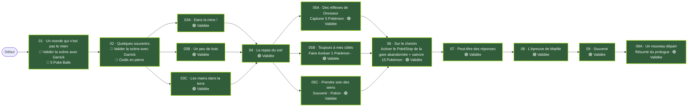
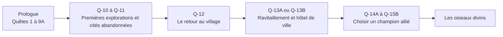
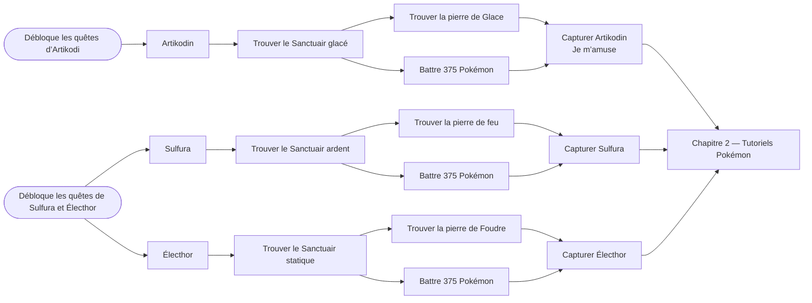

# Pixelmon — Les Échos du Monde

## Acte I : Un monde inconnu — Prologue

| N° | Quête | Objectif principal | Récompense | État |
|---:|---|---|---|---|
| 1 | Un monde qui n’est pas le mien | Valider la scène avec Garrick | 5 Poké Balls | Terminée |
| 2 | Quelques souvenirs | Valider la scène avec Garrick | Pioche, hache, pelle et houe en pierre | Terminée |
| 3A | Dans la mine ! | 32 pierres, 1 four et 16 charbons | 16 torches + récompense supplémentaire à définir | Validée |
| 3B | Un peu de bois | 32 bûches et 1 pousse d’arbre | À définir | Validée |
| 3C | Les mains dans la terre | Obtenir 8 blés et 4 graines de blé | 4 pommes de terre cuites | Validée |
| 4 | Le repas du soir | Reparler à Garrick | 8 pains | Validée |
| 5A | Des réflexes de Dresseur | Capturer 5 Pokémon | 1 000 Pokédollars | Validée |
| 5B | Toujours à mes côtés | Faire évoluer 1 Pokémon | 1 Super Bonbon et 5 Potions | Validée |
| 5C | Prendre soin des siens | Prendre soin de l’équipe ; souvenir d’une Potion | 8 Poudres de Blaze | Validée |
| 6 | Sur le chemin | Activer le PokéStop près de la gare abandonnée et vaincre 15 Pokémon | 2 500 Pokédollars | Validée |
| 7 | Peut-être des réponses | Parler à Maëlle | 1 000 Pokédollars | Validée |
| 8 | L’épreuve de Maëlle | Vaincre les 3 Dresseurs choisis par Maëlle | 5 000 Pokédollars | Validée |
| 9 | Souvenir | Retrouver un souvenir de stratégie | 5 Super Balls | Validée |
| 9A | Un nouveau départ | Lire le résumé du prologue | Aucune | Validée |

## Progression prévue après le prologue

## Chapitre 1 — Premières explorations
 # partie 1

```mermaid
flowchart LR
    Q9A["09A · Un nouveau départ<br/>Résumé du prologue · 🟢 Validée"] --> Q10["10 · Les pistes de Maëlle<br/>Fabriquer les boussoles et le sac à dos · 🟡 À valider"]
    Q10 --> Q11["11 · À la recherche de réponses<br/>Fouiller les coffres et trouver la photographie · 🟡 À valider"]
    Q11 --> Q12["12 · Le retour au village<br/>Un silence inquiétant · 🟡 À valider"]
    Q12 --> AUX1["AUX1 · Checkmark explicatif<br/>Camp ou bateau ?<br/>Le choix ne bloque pas la suite"]
    AUX1 --> Q13A["13A · Le camp de ravitaillement<br/>Installer le camp et récupérer le bloc de l’hôtel de ville · 🟡 À valider"]
    AUX1 --> Q13B["13B · Le bateau de ravitaillement<br/>Installer le bateau et récupérer le bloc de l’hôtel de ville · 🟡 À valider"]
    Q13A --> AUX2["AUX2 · Checkmark explicatif<br/>Arène Glace ou Électrik ?<br/>Le choix ne bloque pas la suite"]
    Q13B --> AUX2
    AUX2 --> Q14A["14A · Vers l’arène Glace<br/>Visiter le village de l’arène · 🟡 À valider"]
    AUX2 --> Q14B["14B · Vers l’arène Électrik<br/>Visiter le village de l’arène · 🟡 À valider"]
    Q14A --> Q15A["15A · Le champion Glace<br/>Vaincre le champion · 🟡 À valider"] --> A1["Quêtes d’Artikodin"]
    Q14B --> Q15B["15B · Le champion Électrik<br/>Vaincre le champion · 🟡 À valider"] --> AUX3["AUX3 · Checkmark explicatif<br/>Électhor ou Sulfura ?<br/>Le choix ne bloque pas la suite"]
    AUX3 --> B1["Quêtes d’Électhor"]
    AUX3 --> C1["Quêtes de Sulfura"]

    
    classDef complete fill:#315d3b,color:#ffffff,stroke:#8fce00,stroke-width:2px;
    classDef planned fill:#5a4a20,color:#ffffff,stroke:#e4c45a,stroke-width:2px;
    class Q9A complete;
    class Q10,Q11,Q12,Q13A,Q13B,Q14A,Q14B,Q15A,Q15B,A1,B1,C1 planned;
    classDef explanatory fill:#39445e,color:#ffffff,stroke:#9aaad0,stroke-dasharray:5 5;
    class AUX1,AUX2,AUX3 explanatory;
```

| N° | Quête | Objectif principal | Récompense | État |
|---:|---|---|---|---|
| 10 | Les pistes de Maëlle | Fabriquer une Explorer’s Compass, une Nature’s Compass et un sac à dos | 2 500 Pokédollars | À valider |
| 11 | À la recherche de réponses | Fouiller les coffres des cités abandonnées et obtenir une photographie de famille | 2 500 Pokédollars (proposition) | À valider |
| 12 | Le retour au village | Retourner au village de Garrick | Aucune | À valider |
| AUX1 | Checkmark explicatif — Camp ou bateau ? | Expliquer le choix entre le camp et le bateau. Ce choix ne bloque pas la suite de l’histoire. | Aucune | Explicatif |
| 13A | Le camp de ravitaillement | Installer le camp et récupérer le bloc de l’hôtel de ville dans son coffre | 5 000 Pokédollars ; débloque le choix d’une arène | À valider |
| 13B | Le bateau de ravitaillement | Installer le bateau et récupérer le bloc de l’hôtel de ville dans son coffre | 5 000 Pokédollars ; débloque le choix d’une arène | À valider |
| AUX2 | Checkmark explicatif — Arène Glace ou Électrik ? | Expliquer le choix entre les deux arènes. Ce choix ne bloque pas la suite de l’histoire. | Aucune | Explicatif |
| 14A | Vers l’arène Glace | Visiter le village de l’arène Glace | Accès au champion Glace | À valider |
| 14B | Vers l’arène Électrik | Visiter le village de l’arène Électrik | Accès au champion Électrik | À valider |
| AUX3 | Checkmark explicatif — Électhor ou Sulfura ? | Expliquer le choix entre les deux oiseaux. Ce choix ne bloque pas la suite de l’histoire. | Aucune | Explicatif |
| 15A | Le champion Glace | Vaincre le champion Glace | Débloque les quêtes d’Artikodin | À valider |
| 15B | Le champion Électrik | Vaincre le champion Électrik | Débloque le choix entre les quêtes d’Électhor et de Sulfura | À valider |

## Chapitre 1 — Premières explorations
 # Partie 2

Le chapitre 2 comprendra un groupe de tutoriels Pokémon à créer : stratégie, EV, IV et talents. Ce groupe s’ouvre après la fin de la quête de l’oiseau divin choisi.
