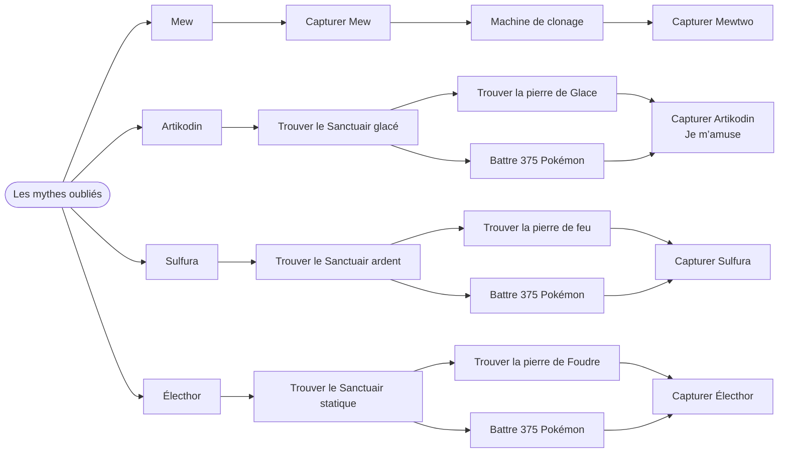
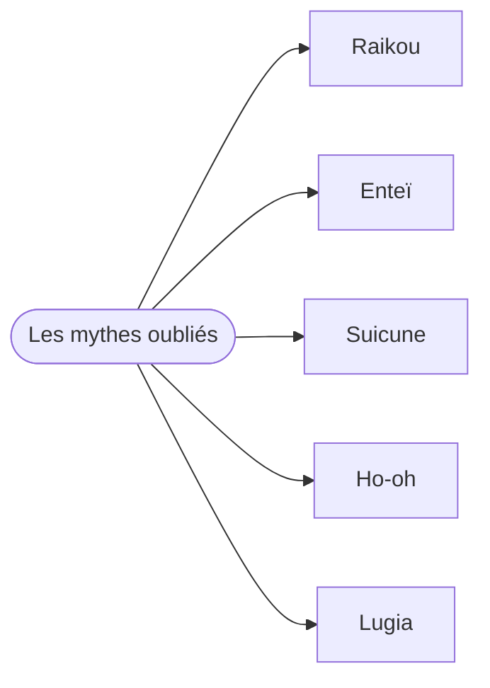
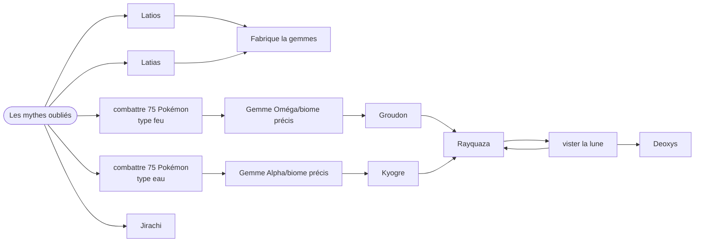

te peut termier ce que j'ai fais et qu'on confirme les chose Pixelmon — Les Échos du Monde

## Les Mythes oubliés
## 1er génération



## Deuxième génération



## Troisième génération, hors Regis



## Quatrième génération

```mermaid
flowchart LR
 A([Les mythes oubliés])
A --> U[Créhelf]
A --> M[Créfollet]
A --> AZ[Créfadet]
U --> RED[Chaine rouge]
M --> RED
AZ --> RED
RED --> A1D[Dialga]
RED --> A1P[palkia]
RED --> G[giratina]
A1P --> P18[plaque]
G --> P18
A1D --> P18
P18 --> AR[arceus]
A --> H[Heatran]
A --> d[Darkrai]
 ```

 ## Les Regis

 ```mermaid
flowchart LR
 A([Les mythes oubliés])
 A --> rock[Regirock]
 A --> ice[Regice]
 A --> steel[Registeel]
 A --> leki[Regieleki]
 A --> dra[Regidrago]
 rock --> gas[Regigigas]
 ice --> gas
 steel --> gas
 leki --> gas
 dra --> gas
 

 ```
## Cinquième génération, partie 1

 ```mermaid
flowchart LR
 A([Les mythes oubliés])
A --> R[Reshiram]
A --> Z[Zekrom]
R --> K[Kyurem]
Z --> K
A --> B[Boréas]
A --> F[Fulguris]
B --> D[Démétéros]
F --> D
D --> A1[Amovénus]
A --> V[Victini]
A --> M[Meloetta]

 ```

 ## Cinquième génération, partie 2

  ```mermaid
flowchart LR
 A([Les mythes oubliés])

 ```
